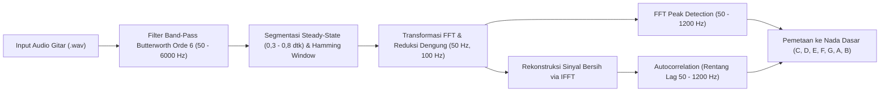

# Analisis Perbandingan Metode Autocorrelation dan Fast Fourier Transform (FFT) Peak Detection untuk Pengenalan Nada Dasar Instrumen Musik Gitar

Proyek ini merupakan implementasi lengkap sistem **Pengolahan Sinyal Digital (PSD)** untuk mendeteksi nada dasar (*frekuensi fundamental* / $F_0$) instrumen musik gitar menggunakan dua pendekatan utama: **FFT Peak Detection** (domain frekuensi) dan **Autocorrelation** (domain waktu), serta dilengkapi **aplikasi web interaktif** yang dapat dijalankan langsung di peramban.

---

## Ringkasan Alur Pemrosesan Sinyal



---

## Ringkasan Hasil Evaluasi Dataset GADA (2.172 Sampel, 5 Model Gitar)

Pengujian dilakukan pada seluruh **2.172 file audio** dari 5 model gitar listrik (`EpiSG`, `Gretsch`, `HBLP`, `HBStrat`, `HBTE52`) serta subset **500 sampel pertama `HBStrat`**:

| Cakupan Evaluasi | Jumlah Sampel | Akurasi FFT Peak Detection | Akurasi Autocorrelation (Input IFFT) | Rentang F0 FFT (Hz) | Rentang F0 Autocorrelation (Hz) |
| :--- | :---: | :---: | :---: | :---: | :---: |
| **Subset 500 Sampel HBStrat** | 500 | 57,40% | **68,00%** | 76,00 – 786,00 | 50,11 – 1225,00 |
| **Seluruh Dataset (5 Model Gitar)** | 2.172 | 58,10% | **78,59%** | 54,00 – 884,00 | 50,11 – 1225,00 |

### Rincian Per Model Gitar

| Model Gitar | Jumlah Sampel | Akurasi FFT (%) | Akurasi Autocorrelation (%) | Rata-rata Waktu FFT (ms) | Rata-rata Waktu ACF (ms) |
| :--- | :---: | :---: | :---: | :---: | :---: |
| **EpiSG** | 161 | 44,10% | **84,47%** | 0,062 | 2,093 |
| **Gretsch** | 422 | 53,79% | **86,97%** | 0,082 | 2,761 |
| **HBLP** | 421 | 56,29% | **82,42%** | 0,068 | 2,300 |
| **HBStrat** | 701 | 59,91% | **73,47%** | 0,076 | 2,503 |
| **HBTE52** | 467 | 65,74% | **73,23%** | 0,069 | 2,454 |

### Temuan Utama
1. **Peran Penting Rekonstruksi IFFT**: Memasukkan sinyal bersih hasil segmentasi *steady-state*, *Hamming Window*, peredaman dengung 50/100 Hz, dan rekonstruksi **IFFT** ke algoritma Autokorelasi mampu menaikkan akurasi secara signifikan hingga **78,59%** (bahkan **86,97%** pada gitar Gretsch).
2. **Keunggulan Masing-masing Metode**: **Autocorrelation** unggul dalam ketepatan pengenalan nada dasar di domain waktu, sedangkan **FFT Peak Detection** unggul pada kecepatan komputasi (**0,073 ms/sampel**) dan kestabilan rentang frekuensi dalam batas wajar instrumen gitar.
3. **Pola Kesalahan**: Kesalahan pada FFT umumnya dipicu oleh puncak energi harmonik yang lebih kuat dari frekuensi fundamental (misalnya nada `A` yang terbaca sebagai harmonik ke-3 di nada `E`).

---

## Struktur Proyek

- [`Project_PSD.ipynb`](file:///d:/KULIAH%20SMT%203/PSD/PROJECT%20PSD/Project_PSD.ipynb) — Notebook utama analisis DSP lengkap (adaptif untuk lokal maupun Google Colab, visualisasi 4 panel sinyal, evaluasi massal 2.172 sampel, matriks kebingungan, dan pemutar audio).
- [`LAPORAN AKHIR 2024 B KELOMPOK 6 PSD.docx`](file:///d:/KULIAH%20SMT%203/PSD/PROJECT%20PSD/LAPORAN%20AKHIR%202024%20B%20KELOMPOK%206%20PSD.docx) — Dokumen laporan akhir penelitian.
- `GUITAR/` — Dataset audio `.wav` dari 5 model gitar GADA.
- `web/` — Aplikasi web interaktif berbasis React + Vite untuk demo langsung di peramban dan *deployment* Vercel.
- [`requirements.txt`](file:///d:/KULIAH%20SMT%203/PSD/PROJECT%20PSD/requirements.txt) — Daftar pustaka Python yang dibutuhkan untuk menjalankan notebook.

---

## Cara Menjalankan Secara Lokal

### 1. Menjalankan Notebook Python (`Project_PSD.ipynb`)
```bash
pip install -r requirements.txt
jupyter notebook Project_PSD.ipynb
```

### 2. Menjalankan Aplikasi Web (`web/`)
```bash
cd web
npm install
npm run dev
```
